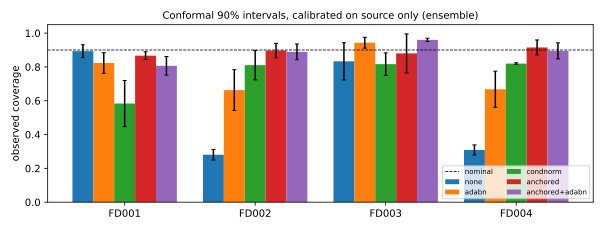
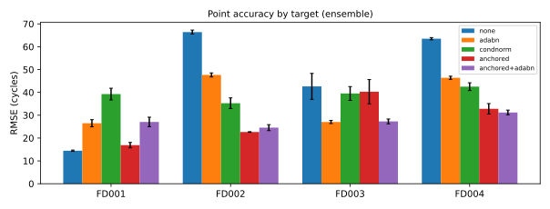

# shift-aware-rul

**Calibrated remaining-useful-life (RUL) prediction when operating conditions shift: what test-time adaptation does to accuracy *and* to uncertainty.**

A model trained on turbofan engines under one operating condition is deployed on engines that run under six conditions, or that fail in a new way. No labels are available from the new fleet. Can label-free test-time adaptation (TTA) recover accuracy, and do the model's prediction intervals still mean what they say afterwards?



## Findings (3 seeds, NASA C-MAPSS, source FD001)

1. **Without adaptation, intervals fail silently under shift.** Conformal 90% intervals calibrated on source engines cover only 28% (FD002) and 31% (FD004) of target engines, while RMSE rises from 14.5 to over 63 cycles.
2. **Standard TTA is not free when there is no shift.** On the in-domain test set, AdaBN raises RMSE from 14.5 to 26.5 and per-condition re-standardization to 39.3. The cause is specific and general: C-MAPSS test trajectories are truncated, so the target population is dominated by healthy states, and re-standardizing on it removes the degradation signal itself.
3. **Health-anchored normalization** (proposed here; per-condition statistics pooled over the first 20 cycles of the target engines, when every engine is still healthy) separates operating-condition shift from health-state shift. It cuts FD002 RMSE from 66.4 to 22.6 with 90% conformal coverage restored (0.90), at a small but significant in-domain cost (+2.5 cycles, 95% CI [1.5, 3.4]).
4. **Different shifts need different adaptations.** A new fault mode (FD003) is helped by AdaBN (−15.8 cycles) and barely by anchored normalization (−2.4). When both shifts occur (FD004), anchored normalization alone and anchored + AdaBN perform similarly (−30.7 and −32.3 cycles; overlapping CIs).
5. **Raw ensemble spread is far too narrow everywhere.** Gaussian intervals from the ensemble's standard deviation cover 5–38% at a nominal 90%, even in-domain; split-conformal rescaling on source data is what makes the intervals usable.

### Ensemble results (mean ± std over 3 seeds; conformal intervals at 90% nominal)

| Target (shift) | Metric | none | AdaBN | condnorm | **anchored** | anchored + AdaBN |
|---|---|---|---|---|---|---|
| FD001 (none) | RMSE | **14.45 ± 0.27** | 26.49 ± 1.57 | 39.27 ± 2.56 | 16.89 ± 1.18 | 27.06 ± 2.07 |
| | coverage | 0.89 ± 0.04 | 0.82 ± 0.06 | 0.58 ± 0.14 | 0.87 ± 0.02 | 0.81 ± 0.06 |
| FD002 (6 conditions) | RMSE | 66.40 ± 0.87 | 47.64 ± 0.89 | 35.25 ± 2.34 | **22.64 ± 0.14** | 24.56 ± 1.31 |
| | coverage | 0.28 ± 0.03 | 0.66 ± 0.12 | 0.81 ± 0.09 | 0.90 ± 0.04 | 0.89 ± 0.05 |
| FD003 (new fault mode) | RMSE | 42.62 ± 5.68 | **27.03 ± 0.68** | 39.51 ± 3.02 | 40.29 ± 5.33 | 27.29 ± 1.06 |
| | coverage | 0.83 ± 0.11 | 0.94 ± 0.03 | 0.82 ± 0.07 | 0.88 ± 0.12 | 0.96 ± 0.01 |
| FD004 (both) | RMSE | 63.51 ± 0.49 | 46.40 ± 0.69 | 42.51 ± 1.70 | 32.80 ± 2.29 | **31.19 ± 1.03** |
| | coverage | 0.31 ± 0.03 | 0.67 ± 0.11 | 0.82 ± 0.00 | 0.92 ± 0.04 | 0.90 ± 0.05 |

Full tables for all three UQ methods (MC dropout, deep ensemble, GP head), NASA scores, interval widths, miscalibration areas, and paired-bootstrap tests are in [`results/three_seeds/summary.md`](results/three_seeds/summary.md).



## Method

**Data.** NASA C-MAPSS turbofan run-to-failure simulations (Saxena et al., 2008). The model is trained on FD001 (one operating condition, one fault mode) and evaluated on the official test engines of all four subsets. RUL labels use the standard piecewise-linear cap at 125 cycles; inputs are 30-cycle windows of the 14 informative sensors; each test engine is scored at its last cycle.

**Model.** A hybrid CNN + LSTM with parallel convolutional and recurrent paths fused before the regression head, in the spirit of Al-Dulaimi et al. (2019). An input BatchNorm layer makes the network's own input statistics adaptable.

**Uncertainty.**
- MC dropout (Gal and Ghahramani, 2016)
- Deep ensemble (Lakshminarayanan et al., 2017)
- Exact Gaussian-process regression on the network's penultimate embeddings
- Normalized split-conformal intervals (Lei et al., 2018) for every method, calibrated on held-out *source* engines only

**Label-free adaptations.**

| Name | What changes at test time | Uses |
|---|---|---|
| `none` | nothing; source statistics | — |
| `adabn` | all BatchNorm statistics re-estimated on target windows (Li et al., 2016) | unlabeled target sensors |
| `condnorm` | sensors z-scored per operating condition (k-means on the settings) using all target data | unlabeled target sensors and settings |
| `anchored` | as `condnorm`, but statistics come only from the first 20 cycles of every target engine, pooled per condition | same, plus the fact that engines start healthy |
| `anchored+adabn` | both | same |

Every target adaptation is fitted on the unlabeled target test set as one batch — the standard test-time adaptation setting (transductive). Target RUL is never used, and conformal quantiles come from source engines only. How much anchored normalization depends on seeing the whole fleet is tested below.

**Statistics.** Each adaptation is compared with `none` by a paired bootstrap over test engines (5,000 resamples); per-engine errors are first averaged across seeds.

## Does anchoring need the whole fleet, and does the anchor length matter?

`scripts/anchor_protocols.py` retrains the source models (three seeds) and evaluates them under three target protocols, and repeats this for anchor lengths 5–50 cycles. Full tables: [`results/anchor_protocols/summary.md`](results/anchor_protocols/summary.md). This retrain ran under newer library versions than `results/three_seeds` (recorded in `run_info.json`), so its absolute numbers differ slightly (FD002 22.85 vs 22.64); protocols are compared on the same trained models.

| Protocol (anchor 20, ensemble) | What the target normalizer sees | FD002 RMSE | FD002 cov. | FD004 RMSE | FD004 cov. |
|---|---|---|---|---|---|
| transductive (main) | clusters from all target cycles; statistics from all engines' first 20 cycles | 22.85 ± 0.45 | 0.91 | 32.18 ± 2.64 | 0.91 |
| early cycles only | clusters and statistics from cycles 1–20 only | 22.85 ± 0.45 | 0.91 | 32.18 ± 2.64 | 0.91 |
| cross-fitted | each half of the fleet normalized with the other half's first 20 cycles | 23.02 ± 0.50 | 0.91 | 32.28 ± 2.63 | 0.91 |

- Clustering on the first 20 cycles alone recovers the same operating regimes, so the results are identical.
- Normalizing each engine only with *other* engines' early-life statistics costs 0.17 (FD002) and 0.10 (FD004) cycles of RMSE, with coverage unchanged: a new engine joining a fleet can be normalized with the statistics of engines already in service.

| Anchor cycles (transductive) | 5 | 10 | 20 | 30 | 50 |
|---|---|---|---|---|---|
| FD002 RMSE | 22.89 | 22.98 | 22.85 | 22.87 | 22.79 |
| FD004 RMSE | 32.47 | 31.27 | 32.18 | 31.89 | 31.75 |
| FD002 / FD004 coverage | 0.91 / 0.90 | 0.92 / 0.95 | 0.91 / 0.91 | 0.91 / 0.89 | 0.91 / 0.92 |

Across 5–50 cycles the result barely moves: the anchor estimates the operating-condition offset, which is large compared with the degradation accumulated in the first few dozen cycles.

```bash
python scripts/anchor_protocols.py --config configs/three_seeds.yaml --anchors 5 10 20 30 50 --out results/anchor_protocols   # ~10 min on 2 CPU cores
```

## Serving: a SageMaker endpoint that detects shift and adapts without labels

The findings above become a deployable service in `src/rul/serving/`:

```
request (one engine or a fleet: raw cycles, JSON or CSV)
   │
   ├─▶ drift monitor: PSI of each operating setting and sensor against the FD001 training fleet
   │
   ├─▶ adaptation = "auto": settings PSI > 0.25 ─▶ health-anchored normalization (condition count estimated
   │                                                from the settings), otherwise source normalization
   ├─▶ ensemble prediction ─▶ split-conformal 90% interval (quantile from source engines only)
   ▼
{rul, lower, upper, sigma} per engine + the drift report + which path was used
```

* **Container** (`serving/Dockerfile`): the SageMaker inference contract, `GET /ping` and
  `POST /invocations` on port 8080, model artifact read from `/opt/ml/model`, started with
  `serve`; JSON or CSV input, SageMaker `CustomAttributes` for options, `/execution-parameters`
  for Batch Transform. CI builds the image, mounts a bundle the way SageMaker does and runs the
  contract checks against the running container.
* **Model bundle** (`python -m rul.serving.bundle`): both source ensembles (source and anchored
  normalization), their conformal quantiles, and the drift baseline, loaded with
  `torch.load(weights_only=True)`.
* **Deployment** (`deploy/sagemaker/deploy.py`): packages `model.tar.gz`, creates the model and
  endpoint config, creates the endpoint or rolls it to the new config; instance endpoints with
  data capture, or serverless.
* **Monitoring** (`deploy/sagemaker/monitor.py`): reads the endpoint's captured requests from S3,
  pools a window of traffic, and publishes `MaxPSISettings`, `MaxPSISensors`,
  `AnchoredFraction` and `CapturedRequests` to CloudWatch.

### The served model on the C-MAPSS test sets

`scripts/serving_eval.py` builds the bundle on FD001 (quick config: one seed, 3-member
ensemble) and sends each test subset through the same `Predictor` the container uses.
Full table: [`results/serving/summary.md`](results/serving/summary.md).

| Target | Conditions estimated / true | PSI settings | PSI sensors | `auto` chose | RMSE: none → auto | Coverage: none → auto |
|---|---|---|---|---|---|---|
| FD001 | 1 / 1 | 0.00 | 0.35 | none | 14.90 → 14.90 | 0.90 → 0.90 |
| FD002 | 6 / 6 | 5.38 | 4.63 | anchored | 66.91 → 23.23 | 0.27 → 0.87 |
| FD003 | 1 / 1 | 0.00 | 1.32 | none | 42.36 → 42.36 | 0.82 → 0.82 |
| FD004 | 6 / 6 | 5.37 | 5.10 | anchored | 63.79 → 35.21 | 0.30 → 0.82 |

* Routing on the **operating settings** picks the right path on all four subsets without
  labels: anchored normalization where conditions shifted, the source model where they did not.
* The **sensor** PSI is not a routing signal: it is 0.35 even in-domain (FD001), because the
  truncated test trajectories are dominated by healthy states (finding 2 above). It is reported
  and monitored as a review signal; on FD003 it rises to 1.32 with the settings unchanged, the
  signature of a new fault mode, which anchored normalization does not fix (finding 4).

```bash
pip install -e ".[serve,aws]"
python -m rul.serving.bundle --config configs/quick.yaml --out model     # a few minutes on CPU
docker build -f serving/Dockerfile -t shift-aware-rul .
docker run -p 8080:8080 -v $PWD/model:/opt/ml/model:ro shift-aware-rul serve
python scripts/serving_eval.py --model model --out results/serving        # the table above

# AWS: push the image to ECR, then
python deploy/sagemaker/deploy.py package --model model --s3 s3://<bucket>/rul/model.tar.gz
python deploy/sagemaker/deploy.py deploy --endpoint rul-shift-aware --image <ecr-image-uri> \
    --model-data s3://<bucket>/rul/model.tar.gz --role <sagemaker-execution-role-arn> \
    --capture s3://<bucket>/rul/capture --wait
python deploy/sagemaker/monitor.py --endpoint rul-shift-aware --capture s3://<bucket>/rul/capture --model model
```

The deployment and monitoring scripts are tested against moto (`tests/test_sagemaker_deploy.py`);
running them for real needs an AWS account and a SageMaker execution role.

## Quick start

```bash
git clone https://github.com/Ghazaleh-Ramezani/shift-aware-rul.git
cd shift-aware-rul
pip install -e ".[dev]"            # CPU PyTorch is enough
python scripts/download_cmapss.py  # or --zip path/to/CMAPSSData.zip from NASA PCoE
pytest -q                          # synthetic-data tests, no download needed

# One seed per job (~3 minutes each on one CPU core), then merge:
for s in 0 1 2; do
  python scripts/run_experiment.py --config configs/three_seeds.yaml --seeds $s --out-dir results/runs/s$s
done
python scripts/merge_runs.py --runs results/runs/s0 results/runs/s1 results/runs/s2 --out results/three_seeds
python scripts/make_figures.py --results results/three_seeds
```

`configs/default.yaml` is the larger setting (5 seeds, 5-member ensembles, 30 epochs). `configs/quick.yaml` is a single-seed smoke run.

## Repository layout

```
src/rul/
  data.py        loading, RUL labels, global / per-condition / health-anchored normalization, windows
  models.py      hybrid CNN + LSTM and training with early stopping
  uq.py          MC dropout, deep ensemble, GP head, Gaussian and conformal intervals
  tta.py         AdaBN
  metrics.py     RMSE, NASA score, coverage, interval width, NLL, calibration curve
  stats.py       paired bootstrap over engines
  experiment.py  experiment driver, run merging, summary tables
  serving/       model bundle, PSI drift monitor, predictor, SageMaker-compatible FastAPI app
serving/         inference Dockerfile
deploy/sagemaker/  package + deploy (boto3), data-capture drift monitor -> CloudWatch
scripts/         run, merge, figures, data download, anchor-protocol robustness, serving evaluation
configs/         quick, three_seeds, default
tests/           synthetic C-MAPSS-format data; runs in CI on every push
```

Every run writes `raw.csv`, `predictions.npz`, `bootstrap.csv`, `summary.md`, and `run_info.json` (resolved config, library versions, git SHA).

## Limitations

- **Small study.** Three seeds and 3-member ensembles trained for at most 15 epochs. The bootstrap intervals resample engines, not seeds, so seed-to-seed variance is reported separately (± std) rather than inside the confidence intervals.
- **One source.** All transfers start from FD001. Reversing the direction (e.g. FD002 → FD001) is a natural next step.
- **Batch adaptation.** All target adaptations use the unlabeled target test set as one batch. For anchored normalization, early-cycle-only clustering and cross-fitting across halves of the fleet give the same results (above); a streaming version that updates the statistics as engines arrive is the natural next step.
- **Anchor length.** The anchor assumes early-life cycles are healthy. Results are stable from 5 to 50 cycles (above); engines shorter than the anchor contribute all their cycles (the shortest FD004 test engine has 19).
- **Strategy selection.** In the study tables each adaptation is label-free but the comparison uses target results. The served model chooses without labels from the settings PSI (above), which separates operating-condition shift from no shift; it does not yet choose AdaBN for a new fault mode (FD003), where the sensor PSI is high but the settings PSI is not.
- **Simulated engines.** C-MAPSS is simulated; real fleets add sensor faults, maintenance events, and censoring that are not modelled here.

## References

- Saxena, A., Goebel, K., Simon, D., and Eklund, N. Damage propagation modeling for aircraft engine run-to-failure simulation. *PHM 2008*.
- Al-Dulaimi, A., Zabihi, S., Asif, A., and Mohammadi, A. A multimodal and hybrid deep neural network model for remaining useful life estimation. *Computers in Industry*, 108, 2019.
- Li, Y., Wang, N., Shi, J., Liu, J., and Hou, X. Revisiting batch normalization for practical domain adaptation. *arXiv:1603.04779*, 2016.
- Gal, Y. and Ghahramani, Z. Dropout as a Bayesian approximation. *ICML 2016*.
- Lakshminarayanan, B., Pritzel, A., and Blundell, C. Simple and scalable predictive uncertainty estimation using deep ensembles. *NeurIPS 2017*.
- Lei, J., G'Sell, M., Rinaldo, A., Tibshirani, R. J., and Wasserman, L. Distribution-free predictive inference for regression. *JASA*, 113(523), 2018.

## License

MIT. The C-MAPSS data are not redistributed here; they are published by the NASA Prognostics Center of Excellence.
